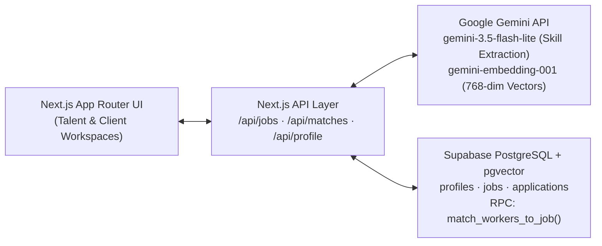

# talent.loop — AI-Powered Gig Marketplace & Quantitative Talent Matching Engine

[](https://talent-loop-bipb.vercel.app)
[](https://nextjs.org/)
[](https://supabase.com/)
[](https://ai.google.dev/)

**talent.loop** is a full-stack, two-sided gig marketplace designed to reduce labor market friction and information asymmetry. Instead of relying on brittle keyword filters, it combines **768-dimensional semantic vector search (`pgvector`)**, **LLM-driven implicit skill extraction**, and an **explainable Multi-Objective Utility engine** with real-time sensitivity analysis.

---

## Key Capabilities

* **Implicit Skill Extraction:** Clients post briefs in plain English. The backend invokes Gemini (`gemini-3.5-flash-lite`) with structured JSON output to infer both explicit and implicit skills, then embeds and indexes the job in `pgvector` automatically.
* **Interactive Multi-Objective Utility Sliders (Sensitivity Analysis):** Clients can dynamically re-weight hiring priorities across **Skill Depth ($\alpha$)**, **Budget Fit ($\beta$)**, **Availability ($\gamma$)**, and **Experience & Verification ($\delta$)** to observe real-time rank shifts.
* **Explainable AI (XAI) Match Breakdowns:** Every match surfaces its exact sub-scores, raw cosine similarity, matched skills, and missing skill gaps rather than an opaque percentage.
* **Dynamic Profile Re-Embedding:** Editing a worker's bio, hourly rate, availability, or skills immediately updates Supabase and regenerates their 768-dim embedding, recalculating marketplace match scores on the fly.
* **Real-Time Labor Market Skill Intelligence:** Computes live skill scarcity across open marketplace briefs to quantify the **addressable market lift** of acquiring a missing high-demand skill.

---

## Quantitative Matching Methodology

For any worker $w$ and job $j$, the platform computes a normalized Multi-Objective Utility score $U(w, j) \in [0, 100]$:

$$U(w, j) = \alpha \cdot S_{\text{skill}}(w, j) + \beta \cdot S_{\text{budget}}(w, j) + \gamma \cdot S_{\text{avail}}(w, j) + \delta \cdot S_{\text{exp}}(w, j)$$

where the user-adjustable preference weights are dynamically normalized such that $\alpha + \beta + \gamma + \delta = 1$.

### Sub-Score Formulations

1. **Hybrid Skill Compatibility ($S_{\text{skill}}$):** Combines calibrated semantic cosine similarity from `pgvector` (65% weight) with explicit + implicit skill set overlap (35% weight):
   $$S_{\text{skill}}(w, j) = 100 \times \left(0.65 \cdot \text{clip}\left(\frac{\cos(\mathbf{v}_w, \mathbf{v}_j) - 0.35}{0.50},\ 0,\ 1\right) + 0.35 \cdot \frac{|K_w \cap K_j|}{|K_j|}\right)$$
2. **Budget Compatibility ($S_{\text{budget}}$):** Scores $100$ when the worker's hourly rate $r_w \in [b_{\min}, b_{\max}]$, $95$ when under budget, and applies a linear penalty proportional to the overage ratio above $b_{\max}$.
3. **Availability Fit ($S_{\text{avail}}$):** Evaluates weekly worker capacity against the required delivery bandwidth for the project's estimated hours.
4. **Experience & Verification ($S_{\text{exp}}$):** Weighted blend of experience-level fit (70%) and verified skill credential ratio (30%).

---

## System Architecture



---

## Tech Stack ($0 Production Architecture)

| Layer | Technology | Role |
| :--- | :--- | :--- |
| **Frontend** | Next.js (App Router), React, TypeScript, Tailwind CSS, Recharts | Two-sided workspace UI, utility sliders, earnings & skill visualizations |
| **Database & Vector Store** | Supabase (PostgreSQL + `pgvector`) | Relational schema, Row Level Security (RLS), cosine similarity RPC |
| **AI / NLP** | Google GenAI SDK (`@google/genai`) | Implicit skill extraction & 768-dim semantic embeddings |
| **Deployment** | Vercel (Hobby Plan) | Serverless Next.js hosting with CI/CD from GitHub |

---

## API Reference

| Endpoint | Method | Description |
| :--- | :--- | :--- |
| `/api/jobs` | `GET` | Fetches live open jobs with joined client metadata from Supabase. |
| `/api/jobs` | `POST` | Extracts implicit skills via Gemini, generates a 768-dim vector, and persists the job. |
| `/api/matches` | `GET` | Client-side ranking: runs `pgvector` RPC + Multi-Objective Utility with query weights (`wSkill`, `wBudget`, `wAvailability`, `wExperience`). |
| `/api/matches` | `POST` | Worker-side ranking: scores all open jobs against the worker's live vector and computes Skill Intelligence market lift. |
| `/api/profile` | `GET` / `PATCH` | Reads or updates a worker profile and automatically regenerates its `pgvector` embedding on save. |
| `/api/ai/embed-seed` | `GET` | One-time utility route to backfill 768-dim embeddings for seeded profiles and jobs. |

---

## Local Development

1. **Clone the repository**
   ```bash
   git clone [https://github.com/KhushiParekh28/Talent-loop.git](https://github.com/KhushiParekh28/Talent-loop.git)
   cd Talent-loop
   npm install
   ```

2. **Configure environment variables**
   Create a `.env.local` file in the project root:
   ```env
   NEXT_PUBLIC_SUPABASE_URL=your_supabase_project_url
   NEXT_PUBLIC_SUPABASE_PUBLISHABLE_KEY=your_supabase_publishable_key
   GEMINI_API_KEY=your_gemini_api_key
   ```

3. **Run the development server**
   ```bash
   npm run dev
   ```
   Open [http://localhost:3000](http://localhost:3000) to explore both the **Talent view** and **Client view**.

---

## Roadmap

* **Operations Research Team Allocation:** Multi-job bipartite matching / Hungarian algorithm solver for optimal agency-wide talent assignment under budget and capacity constraints.
* **End-to-End Authentication:** Supabase Auth with role-based onboarding for workers and clients.